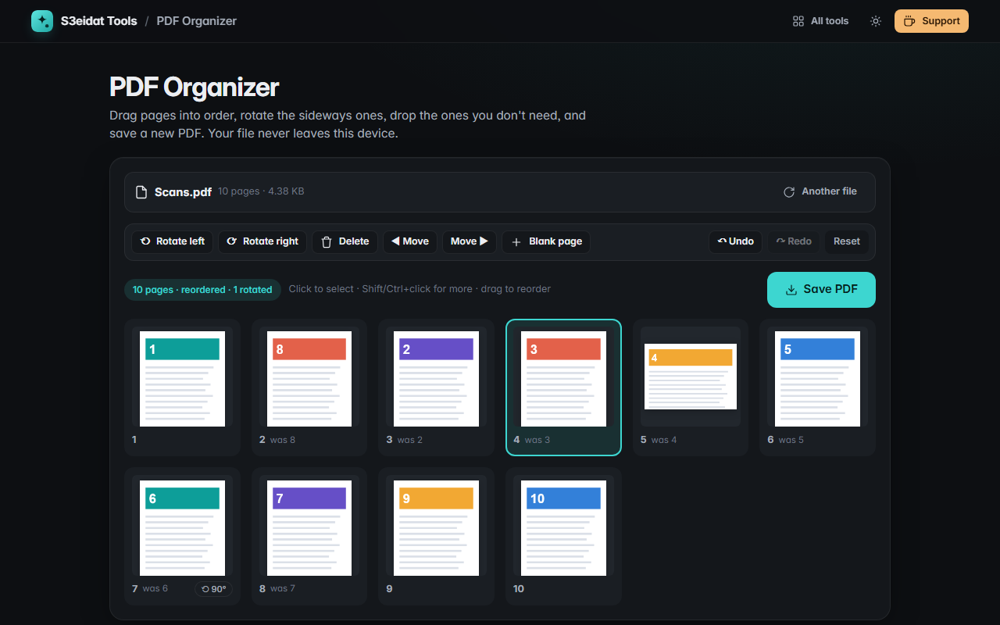

# PDF Organizer

> Reorder, rotate and delete PDF pages. Free, private, and it runs entirely in your browser.

### ▶ [Open PDF Organizer](https://s3eidat.github.io/pdf-organizer/)



## Features

- **Thumbnail grid** of every page
- **Drag to reorder**, or select pages and use Move / <kbd>Ctrl</kbd>+<kbd>←</kbd> <kbd>→</kbd>
- **Rotate** one page, the selection, or all pages (left or right)
- **Delete** pages (button or <kbd>Delete</kbd>)
- **Insert a blank page** after the selection, sized like the page next to it
- **Undo / redo** every step (<kbd>Ctrl</kbd>+<kbd>Z</kbd> / <kbd>Ctrl</kbd>+<kbd>Y</kbd>) and reset to the original
- Multi-select with Shift/Ctrl+click; keyboard friendly (arrows to move focus, <kbd>R</kbd> to rotate)
- Save as a new PDF; your original file is never changed
- Clear error for **password-protected/encrypted** files

## Privacy

Your PDF never leaves your device: it is read, previewed and saved by JavaScript in this tab. There is no server, no account,
no analytics. The page ships with a strict Content-Security-Policy (`connect-src 'self'`), so the browser itself blocks any
attempt to send data anywhere.

## Run it yourself

It's plain HTML, CSS and JavaScript with no build step:

```bash
git clone https://github.com/s3eidat/pdf-organizer
cd pdf-organizer
python -m http.server 8000
```

Then open http://localhost:8000.

## Credits

Previews by [PDF.js](https://mozilla.github.io/pdf.js/) (Mozilla, Apache-2.0) and PDF editing by
[pdf-lib](https://pdf-lib.js.org/) (Andrew Dillon, MIT), both shipped in `lib/`.

## Support

If this saved you time, **[buy me a coffee ☕](https://s3eidat.github.io/coffee/)**. It keeps every tool free.

---

Part of **[S3eidat Tools](https://s3eidat.github.io/)**: 100+ free, private tools that run in your browser. MIT licensed.
